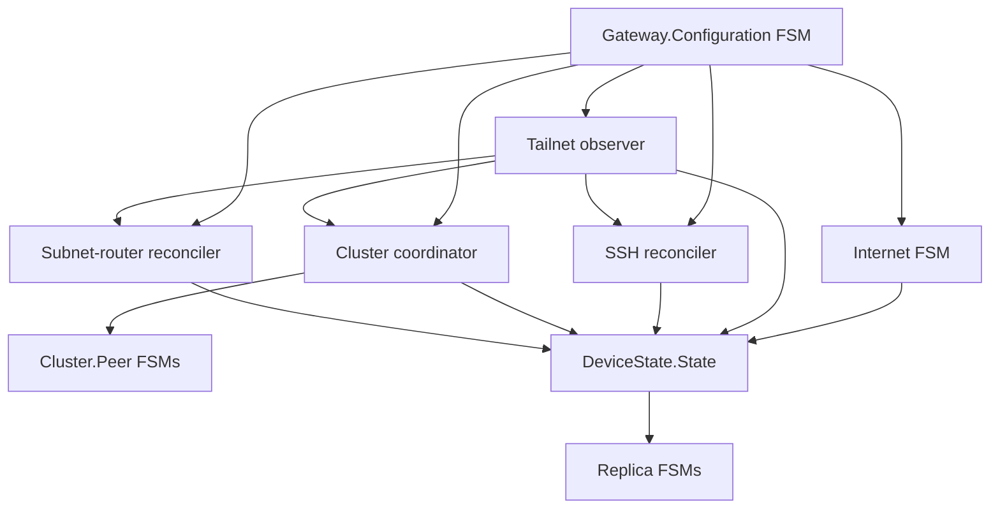

# Command, event, and state architecture

This document records the implementation rules for NervesGate. It is not a
migration ledger.

## Vocabulary

- **Command** expresses desired intent and is sent to the owner of the affected
  resource.
- **Event** reports completed or observed reality.
- **Private state** is owned by one subsystem process.
- **Public state** is the canonical secret-free `DeviceState.State` projection.

## Invariants

1. One process owns mutation of each external resource.
2. Accepted desired settings are durable before a runtime owner is commanded.
3. Mutations of one resource never overlap.
4. Long-running work is bounded and dies with its owner.
5. Restart recovery observes external reality before mutating it again.
6. DeviceState is typed, secret-free, atomically snapshotable, and revisioned.
7. Erlang references remain private; durable workflows use serializable IDs.
8. A revision gap or boot-ID change installs a fresh snapshot without buffering.

## Process selection

A process is a Finitomata FSM only when its current phase changes which events
are legal and the graph explains important temporal behavior.

Current FSMs:

- `NervesGate.Gateway.Configuration` — candidate staging, confirmation, timeout,
  promotion, and rollback.
- `NervesGate.Internet` — apply, verify, restore, and retry transaction.
- `NervesGate.Cluster.Peer` — discovery, group classification, connection, and
  backoff for one peer.
- `NervesGate.DeviceState.Replica` — snapshot synchronization and revision-gap
  recovery.

Ordinary GenServers:

- Tailnet observation and classification.
- SSH desired-state reconciliation.
- Cluster distribution coordination.
- Subnet-route reconciliation.
- Commissioning interface reconciliation.
- DeviceState serving, dependency projection, alarms, startup gating, and
  replica scanning.

A timer, retry counter, or stateful process is not by itself a reason to create
an FSM. A graph dominated by self-transitions or worker phases is a signal to
use a GenServer.



## Idiomatic Finitomata subset

FSM modules use standard `syntax: :state_diagram`. `on_transition/4` is the
reducer and returns Finitomata's native `{:ok, next_state, payload}` value. The
repo does not define a second reducer callback or a custom parser.

Runtime work is represented by at most one explicit private effect in the
payload. `NervesGate.FSM.Listener` publishes the committed projection and
queues that effect. `NervesGate.FSM.Effect` supplies only supervision, owner
monitoring, timeout, deduplication, and completion-event delivery. Domain logic,
retry policy, and resource serialization stay in the owner.

Finitomata's own bounded history, transition validation, timers, and generated
documentation are used directly. The repo does not maintain a parallel
transition-history format.

## Desired-state settings

SSH and subnet routing are normal durable desired settings:

```text
validate → persist accepted settings → command owner → asynchronous convergence
```

They do not use a durable resource-change saga. A runtime failure does not roll
back accepted intent. DeviceState exposes desired and observed reality, and the
owner retries until they converge or a newer desired value supersedes the old
one.

The guarded candidate workflow remains transactional because it temporarily
changes remote access and must support confirmation and rollback.

## Runtime effects

Observers may perform bounded reads directly in their owner when serialization
is sufficient. Potentially long mutations use a supervised effect. One effect
captures the desired revision at launch; completion for an older revision may
update observed evidence but cannot declare convergence. The owner immediately
reconciles the newest desired revision afterward.

Correlation is local correctness machinery, not a public workflow model.

## DeviceState

Owners publish complete slices such as:

```elixir
{:state_reported, :ssh, %NervesGate.SSH.Status{}}
```

`DeviceState.Server` authenticates the current supervised owner, recursively
rejects secrets, deduplicates unchanged slices, increments the revision, stores
the new projection, and broadcasts one event. It performs no lifecycle work.

Consumers install one atomic snapshot and then apply exactly ordered events.
They request another snapshot on malformed input, a revision gap, or a boot-ID
change.

## Dependency direction

```text
NervesGate facade → owners → runtime/platform boundaries
owners → DeviceState → web/API/alarms/dependencies/replicas
```

The web layer uses only the `NervesGate` facade and public state types. Runtime
modules do not know DeviceState exists. Dependencies only forward public
Tailnet evidence to SSH, Cluster, and SubnetRouter; they own no lifecycle.

## Validation

Changes must preserve:

- root tests and standalone QEMU tests;
- formatting and warnings-as-errors compilation;
- Credo strict, Dialyzer, ExDNA, and Reach architecture checks;
- x86_64 target compilation;
- ExDoc rendering the executable Finitomata declarations and architecture graph.
