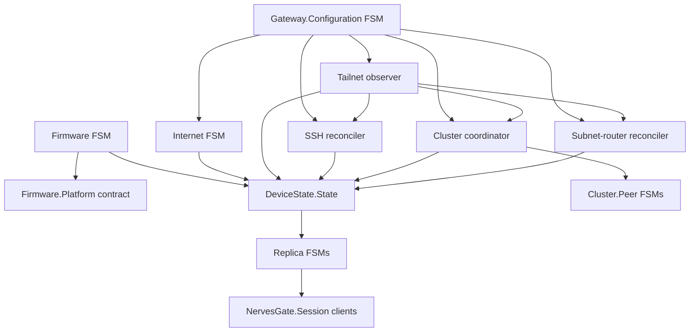

# Command, event, and state architecture

This document records the implementation rules for NervesGate. It is not a
migration ledger.

## Vocabulary

- **Command** expresses desired intent and is sent to the owner of the affected
  resource.
- **Event** reports completed or observed reality.
- **Private state** is owned by one subsystem process.
- **Public state** is the canonical secret-free `DeviceState.State` projection.

## Invariants

1. One process owns mutation of each external resource.
2. Accepted desired settings are durable before a runtime owner is commanded.
3. Mutations of one resource never overlap.
4. Long-running work is bounded and dies with its owner.
5. Restart recovery observes external reality before mutating it again.
6. DeviceState is typed, secret-free, atomically snapshotable, and revisioned.
7. Erlang references remain private; durable workflows use serializable IDs.
8. A revision gap or boot-ID change installs a fresh snapshot without buffering.
9. Remote liveness uses a bounded heartbeat lease, not full-state polling or
   Erlang's distribution timeout.
10. Firmware installation can reach a platform only after detached manifest,
    digest, fwup signature, metadata, compatibility, and health validation.
11. A trial remains unvalidated until sustained health and explicit acceptance
    from a fresh Tailnet connection; the previous known-good image remains the
    fallback until then.

## Process selection

A process is a Finitomata FSM only when its current phase changes which events
are legal and the graph explains important temporal behavior.

Current FSMs:

- `NervesGate.Gateway.Configuration` — explicit scoped updates, candidate
  staging, Keep confirmation, timeout, promotion, and retrying rollback.
- `NervesGate.Firmware` — discovery, persistent download, verification,
  preflight, inactive-slot installation, trial health, acceptance, and rollback.
- `NervesGate.Internet` — apply, verify, restore, and retry transaction.
- `NervesGate.Cluster.Peer` — discovery, group classification, connection, and
  backoff for one peer.
- `NervesGate.DeviceState.Replica` — snapshot synchronization and revision-gap
  recovery.

Ordinary GenServers:

- Tailnet observation and classification.
- SSH desired-state reconciliation.
- Cluster distribution coordination.
- Subnet-route reconciliation.
- Commissioning interface reconciliation.
- DeviceState serving, alarms, startup gating, replica scanning, and disposable
  client-session projection.

A timer, retry counter, or stateful process is not by itself a reason to create
an FSM. A graph dominated by self-transitions or worker phases is a signal to
use a GenServer.



## Idiomatic Finitomata subset

FSM modules use standard `syntax: :state_diagram`. `on_transition/4` is the
reducer and returns Finitomata's native `{:ok, next_state, payload}` value. The
repo does not define a second reducer callback or a custom parser.

Runtime work is represented by at most one explicit private effect in the
payload. `NervesGate.FSM.Listener` publishes the committed projection and
queues that effect. `NervesGate.FSM.Effect` supplies only supervision, owner
monitoring, timeout, deduplication, and completion-event delivery. Domain logic,
retry policy, and resource serialization stay in the owner.

Finitomata's own bounded history, transition validation, timers, and generated
documentation are used directly. The repo does not maintain a parallel
transition-history format.

## Desired-state settings

SSH and subnet routing are normal durable desired settings:

```text
validate → persist accepted settings → command owner → asynchronous convergence
```

They do not use a durable resource-change saga. A runtime failure does not roll
back accepted intent. DeviceState exposes desired and observed reality, and the
owner retries until they converge or a newer desired value supersedes the old
one.

The guarded candidate workflow remains transactional because it temporarily
changes remote access and must support explicit Keep confirmation and rollback.
Opening `/commissioning` is inert: only a submitted scoped Update command creates
a candidate. Unkept candidates revert on their deadline, and failed rollback
effects retain the candidate and retry rather than declaring success.

## Firmware transaction

Firmware is a separate resource owner and DeviceState slice. GitHub Releases is
an untrusted distribution source: exact manifest bytes must pass detached
Ed25519 verification before their artifact URL or metadata is used. The artifact
is downloaded to persistent storage, resumed safely, fsynced, and checked for
size, SHA-256, fwup signature, and exact product/system/platform/architecture,
version, UUID, and VCS metadata before preflight.

The owner depends on a generic `NervesGate.Firmware.Platform` contract, never on
partition names or bootloader flags. A platform that cannot report automatic
trial fallback is read-only. Installation records a durable serializable journal
before writing the inactive candidate. A new unvalidated boot runs public-state
health checks until stable; explicit acceptance requires a fresh Tailnet session
and commits through the platform. Timeout, sustained management loss, explicit
rollback, or any unvalidated reboot returns to the previous known-good image.
After fallback, the platform synchronizes its physically running slot and
next-boot authority before another inactive-slot write is legal. The journal is
cleared only after committed validation or after the restored firmware observes
completed fallback.

Shared `/data` migrations must remain backward-compatible while a firmware is a
trial. Destructive migrations are deferred until validation or require their own
rollback-safe strategy.

## Runtime effects

Observers may perform bounded reads directly in their owner when serialization
is sufficient. Potentially long mutations use a supervised effect. One effect
captures the desired revision at launch; completion for an older revision may
update observed evidence but cannot declare convergence. The owner immediately
reconciles the newest desired revision afterward.

Correlation is local correctness machinery, not a public workflow model.

## DeviceState

Owners publish complete slices such as:

```elixir
{:state_reported, :ssh, %NervesGate.SSH.Status{}}
```

`DeviceState.State.apply_event/2` is the pure reducer. Every operation is a
past-tense `:state_reported` tuple containing one owner's complete public slice.
The reducer validates the source and slice shape and replaces only that source's
field. It never reads runtime state, performs effects, emits commands, or merges
partially observed structures. Reducing the same ordered event stream from the
same snapshot therefore produces the same projection.

`DeviceState.Server` is the serializer for one gateway. For every submitted
operation it:

1. authenticates the caller as the current local supervised owner of the slice;
2. recursively rejects secrets and BEAM-local runtime values;
3. invokes the reducer;
4. drops an operation whose resulting state is unchanged;
5. increments its boot-scoped revision; and
6. broadcasts the accepted operation after the subscriber's atomic join.

The server performs no lifecycle work. Desired commands never enter this stream;
only complete committed or observed public reality does.

Consumers atomically join to obtain `{boot_id, revision, state}` and then apply
only the exact next revision. Duplicate revisions are ignored. Malformed input,
a revision gap, or a boot-ID change discards incremental synchronization and
installs another atomic snapshot without buffering or replay.

Remote reducer clients additionally receive a one-second heartbeat containing
only the source node, boot ID, and current revision. Heartbeats are transport
evidence rather than state operations: they never enter the reducer or consume
a revision. If no event or heartbeat arrives within the 2.5-second lease, the
client immediately publishes its retained snapshot as disconnected. Successful
rejoining installs a snapshot before connectivity is reported again.

`NervesGate.Session` is the client boundary over these streams. `connect/0`
returns a disposable session PID and complete initial fleet state. That process
owns reducer application, duplicate handling, gap recovery, and remote-replica
updates, then pushes complete `{:nerves_gate_state_changed, session, fleet}`
messages to its monitored client. LiveViews, controllers, and integration tools
never apply DeviceState events themselves.

## Dependency direction

```text
NervesGate facade → owners → runtime/platform boundaries
owners → DeviceState → web/API/alarms/replicas/sessions
```

The web layer uses only the thin `NervesGate` session and command facade.
Runtime adapters do not know DeviceState exists. SSH, Cluster, and SubnetRouter
read Tailnet's current typed observation during their own supervised
reconciliation instead of maintaining a second public-state projection.

## Validation

Changes must preserve:

- root tests and standalone QEMU tests;
- formatting and warnings-as-errors compilation;
- Credo strict, Dialyzer, ExDNA, and Reach architecture checks;
- x86_64 target compilation;
- ExDoc rendering the executable Finitomata declarations and architecture graph.
