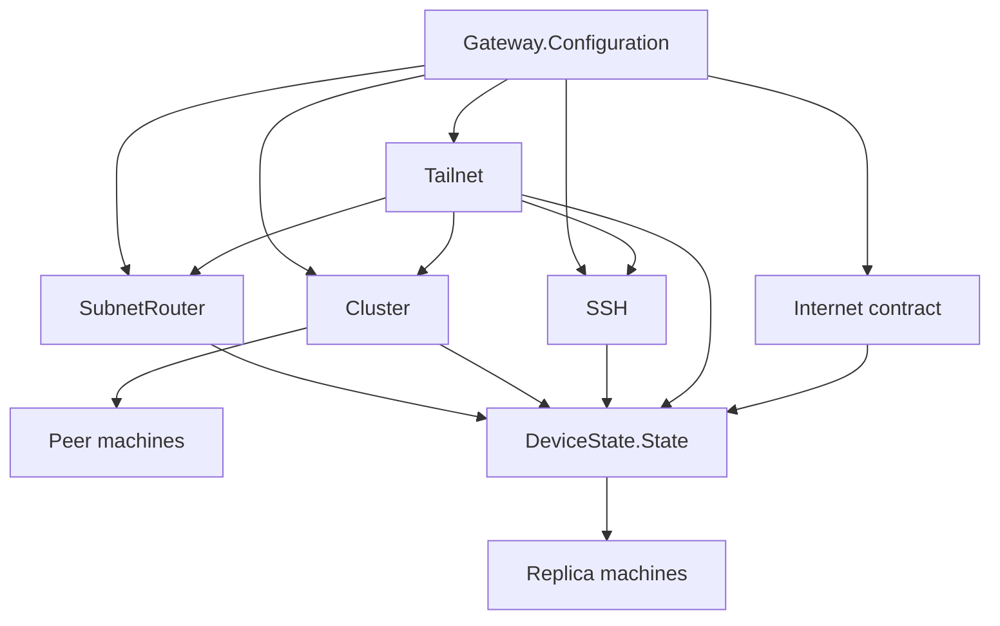
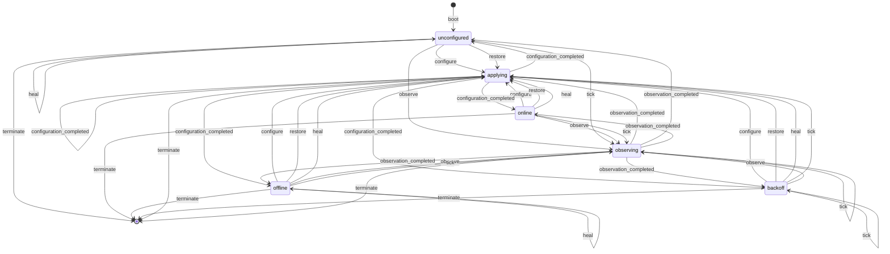
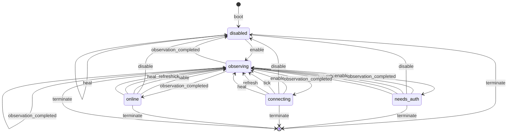
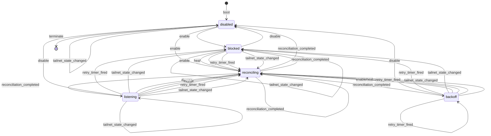
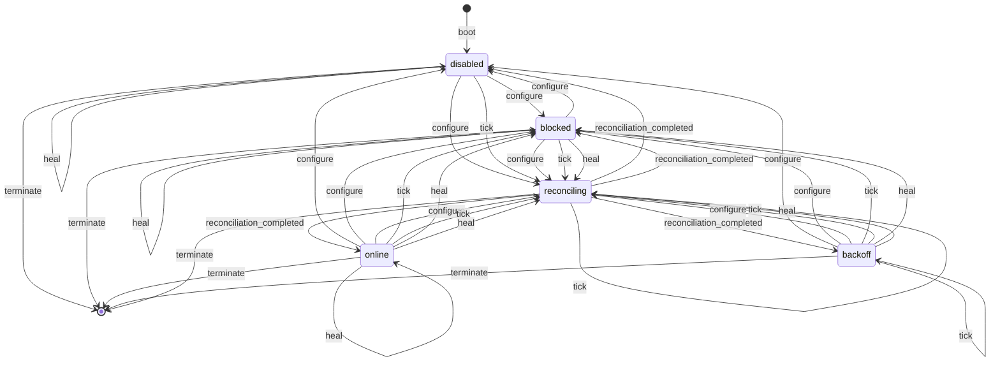
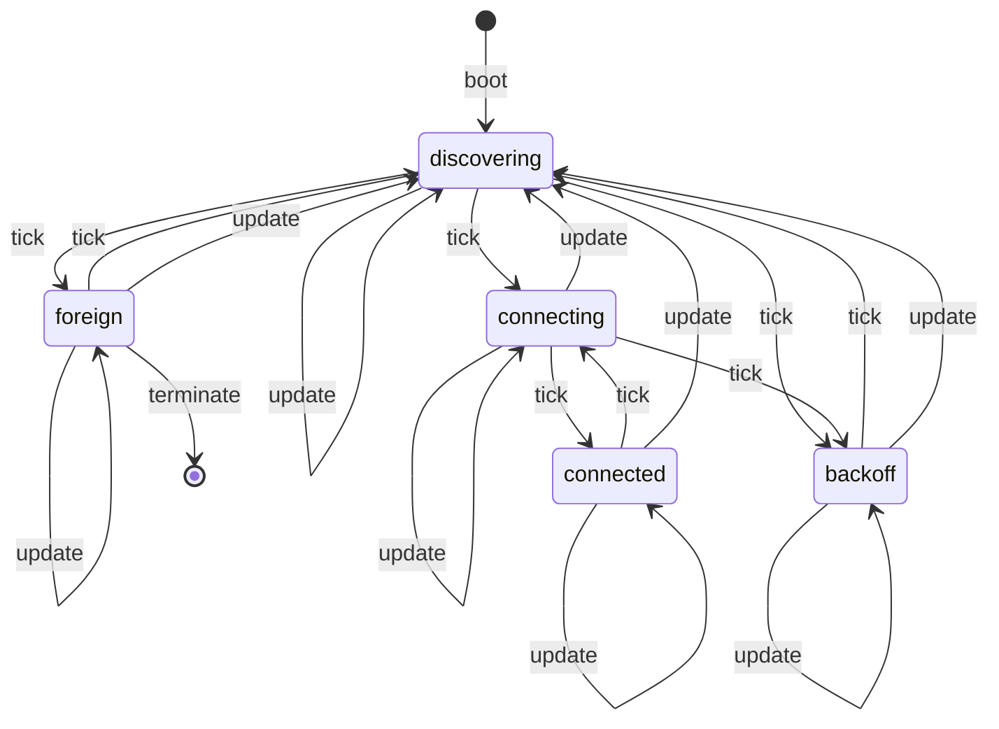
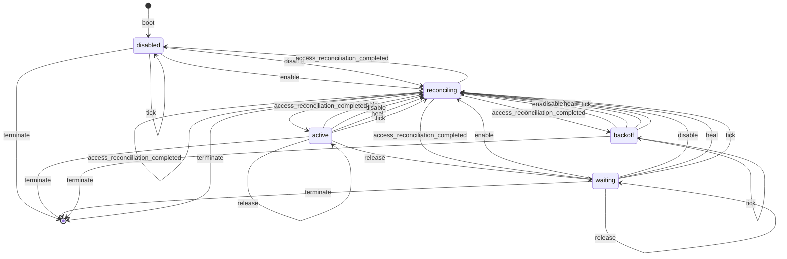
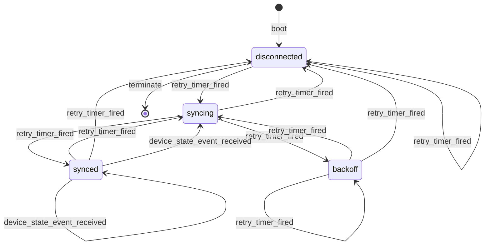

# Lifecycle machines

This file is generated by `mix nerves_gate.fsm_docs`. Each Mermaid diagram is
emitted from the same `@fsm` declaration compiled by Finitomata. Edit the subsystem
entry module, not this file, then regenerate it.

## Dependency overview

## Internet

Source: `NervesGate.Internet`

## Tailnet

Source: `NervesGate.Tailnet`

## SSH

Source: `NervesGate.SSH`

## Cluster

Source: `NervesGate.Cluster`

## Cluster peer

Source: `NervesGate.Cluster.Peer`

## Subnet router

Source: `NervesGate.SubnetRouter`

```mermaid
stateDiagram-v2
  [*] --> disabled : boot
  disabled --> applying : configure
  disabled --> blocked : configure
  disabled --> disabled : retry_timer_fired
  disabled --> disabled : tailnet_state_changed
  disabled --> disabled : heal
  blocked --> applying : configure
  blocked --> blocked : configure
  blocked --> applying : retry_timer_fired
  blocked --> applying : tailnet_state_changed
  blocked --> applying : heal
  blocked --> blocked : retry_timer_fired
  blocked --> blocked : tailnet_state_changed
  blocked --> blocked : heal
  awaiting_approval --> applying : configure
  awaiting_approval --> blocked : configure
  awaiting_approval --> applying : heal
  awaiting_approval --> active : tailnet_state_changed
  awaiting_approval --> awaiting_approval : tailnet_state_changed
  awaiting_approval --> blocked : tailnet_state_changed
  awaiting_approval --> active : retry_timer_fired
  awaiting_approval --> awaiting_approval : retry_timer_fired
  awaiting_approval --> blocked : retry_timer_fired
  active --> applying : configure
  active --> blocked : configure
  active --> applying : heal
  active --> active : tailnet_state_changed
  active --> awaiting_approval : tailnet_state_changed
  active --> blocked : tailnet_state_changed
  active --> active : retry_timer_fired
  active --> awaiting_approval : retry_timer_fired
  active --> blocked : retry_timer_fired
  backoff --> applying : configure
  backoff --> blocked : configure
  backoff --> applying : heal
  backoff --> applying : retry_timer_fired
  backoff --> applying : tailnet_state_changed
  backoff --> backoff : retry_timer_fired
  backoff --> blocked : retry_timer_fired
  backoff --> blocked : tailnet_state_changed
  applying --> applying : configure
  applying --> applying : heal
  applying --> applying : retry_timer_fired
  applying --> applying : tailnet_state_changed
  applying --> applying : routes_application_completed
  applying --> disabled : routes_application_completed
  applying --> blocked : routes_application_completed
  applying --> awaiting_approval : routes_application_completed
  applying --> active : routes_application_completed
  applying --> backoff : routes_application_completed
  disabled --> [*] : terminate
```

## Commissioning

Source: `NervesGate.Commissioning`

## Gateway configuration

Source: `NervesGate.Gateway.Configuration`

```mermaid
stateDiagram-v2
  [*] --> activating : boot
  activating --> idle : activation_completed
  activating --> activating : tick
  activating --> activating : public_state_requested
  activating --> activating : runtime_state_changed
  activating --> [*] : terminate
  idle --> awaiting_runtime_change : resume_runtime_change
  awaiting_runtime_change --> awaiting_runtime_change : resume_runtime_change
  idle --> executing_change : stage_internet
  idle --> executing_change : begin_tailnet_change
  idle --> executing_change : begin_cluster_change
  needs_tailnet --> executing_change : update_internet
  needs_cluster --> executing_change : update_internet
  needs_confirmation --> executing_change : update_internet
  needs_tailnet --> executing_change : stage_tailnet
  needs_cluster --> executing_change : stage_tailnet
  needs_confirmation --> executing_change : stage_tailnet
  needs_cluster --> executing_change : stage_cluster
  needs_confirmation --> executing_change : stage_cluster
  needs_confirmation --> executing_change : confirm
  needs_tailnet --> executing_change : revert
  needs_cluster --> executing_change : revert
  needs_confirmation --> executing_change : revert
  needs_tailnet --> needs_tailnet : tick
  needs_tailnet --> executing_change : tick
  needs_cluster --> needs_cluster : tick
  needs_cluster --> executing_change : tick
  needs_confirmation --> needs_confirmation : tick
  needs_confirmation --> executing_change : tick
  executing_change --> idle : configuration_step_completed
  executing_change --> needs_tailnet : configuration_step_completed
  executing_change --> needs_cluster : configuration_step_completed
  executing_change --> needs_confirmation : configuration_step_completed
  executing_change --> executing_change : tick
  executing_change --> executing_change : public_state_requested
  executing_change --> [*] : terminate
  idle --> idle : tick
  idle --> persisting_runtime_change : configure_subnet_router
  idle --> persisting_runtime_change : configure_ssh
  idle --> idle : configure_subnet_router
  idle --> idle : configure_ssh
  idle --> idle : heal
  idle --> awaiting_runtime_change : heal
  idle --> idle : runtime_state_changed
  persisting_runtime_change --> awaiting_runtime_change : runtime_change_persistence_completed
  persisting_runtime_change --> idle : runtime_change_persistence_completed
  awaiting_runtime_change --> awaiting_runtime_change : runtime_command_finished
  awaiting_runtime_change --> finalizing_runtime_change : runtime_command_finished
  finalizing_runtime_change --> finalizing_runtime_change : runtime_command_finished
  awaiting_runtime_change --> awaiting_runtime_change : runtime_state_changed
  awaiting_runtime_change --> finalizing_runtime_change : runtime_state_changed
  finalizing_runtime_change --> idle : runtime_change_persistence_completed
  persisting_runtime_change --> persisting_runtime_change : tick
  awaiting_runtime_change --> awaiting_runtime_change : tick
  finalizing_runtime_change --> finalizing_runtime_change : tick
  needs_tailnet --> needs_tailnet : heal
  needs_cluster --> needs_cluster : heal
  needs_confirmation --> needs_confirmation : heal
  idle --> idle : public_state_requested
  needs_tailnet --> needs_tailnet : public_state_requested
  needs_cluster --> needs_cluster : public_state_requested
  needs_confirmation --> needs_confirmation : public_state_requested
  persisting_runtime_change --> persisting_runtime_change : public_state_requested
  awaiting_runtime_change --> awaiting_runtime_change : public_state_requested
  finalizing_runtime_change --> finalizing_runtime_change : public_state_requested
  idle --> [*] : terminate
  persisting_runtime_change --> [*] : terminate
  awaiting_runtime_change --> [*] : terminate
  finalizing_runtime_change --> [*] : terminate
```

## Device-state replica

Source: `NervesGate.DeviceState.Replica`

